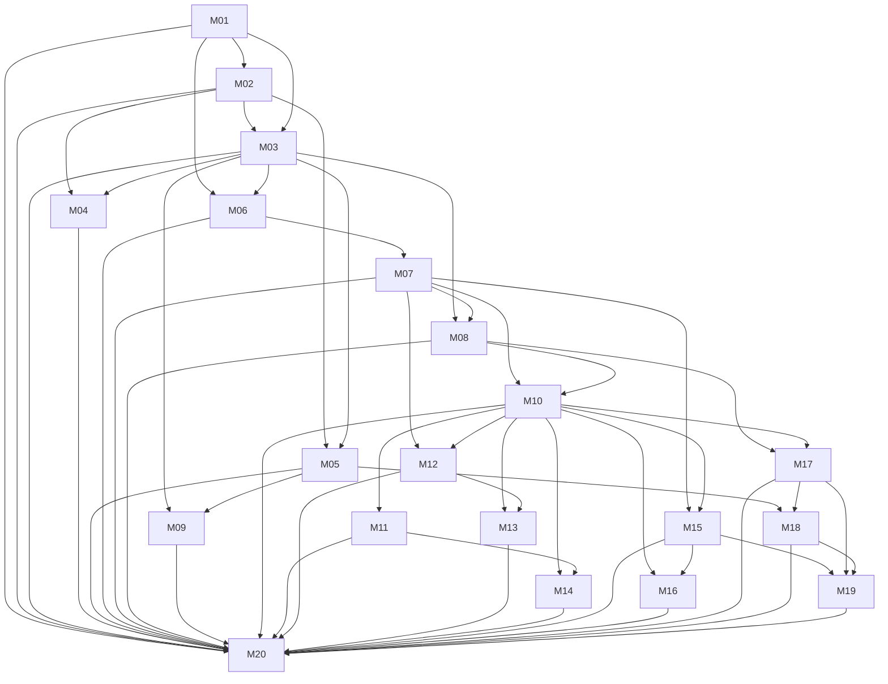

# M01–M20 学习路径与课程依赖图

> 审计基准：课程版本 0.40.9；仓库 main HEAD 7dcfe7a4e9259e71b00e337ead867d0ab77d18c2。依据当前工作区 courseCatalog、M01–M20 课程源文件、教师指南和实验工作簿建立。课程顺序不是简单线性阅读顺序，先修边以课程目录声明为准。

## 1. 培养目标与学习者画像

面向具备基本计算机使用能力、希望从模型原理走向 AI 应用与系统工程交付的开发者、软件工程师、技术产品人员和跨职能工程团队。本课程不是数学系机器学习理论专业课的替代，也不是只教授 Prompt 技巧的应用速成班。

完成 M01–M20 后，学习者应能够：
1. 解释现代 AI/ML/LLM 的基本概念、训练和推理机制；
2. 设计、实现和评估以模型为组件的应用；
3. 构建受控 Agent、工具、MCP/Skills 和工作流集成；
4. 将安全、权限、数据治理、可靠性、评测和可观测性纳入设计；
5. 进行平台级成本、容量、租户和产品运营决策；
6. 以需求、架构、实现、测试和证据完成端到端 Capstone。

## 2. 课程地图

| 模块 | 定位 | 核心知识 | 主要能力/产出 | 先修 |
|---|---|---|---|---|
| M01 | AI 系统基础 | AI/ML/DL/LLM、训练/泛化、能力边界、系统分层 | AI 系统分解图、风险与验证清单 | 无 |
| M02 | 模型架构 | 序列、QKV、Attention、Mask、位置、Transformer Block、复杂度 | 手算 Attention、张量/Mask 说明 | M01 |
| M03 | 输入表示 | Tokenization、Token ID、Embedding、Context Window、序列化和预算 | Token/Context 审计报告 | M01、M02 |
| M04 | 模型训练 | 预训练目标、数据工程、Dense/MoE、SFT、LoRA/QLoRA、PPO/DPO/RLAIF | 训练/数据审查、微调和发布档案 | M02、M03 |
| M05 | 推理服务 | Prefill/Decode、KV Cache、解码、Batching、量化、容量与 SLO | 容量账本、调度策略、推理架构 | M02、M03 |
| M06 | Prompt 应用 | Prompt 契约、Few-shot、结构化输出、注入、Judge、回归 | Prompt manifest、攻击矩阵、发布门禁 | M01、M03 |
| M07 | 工具调用 | Provider Tool Calling、Schema、路由、副作用、幂等、分层评测 | 工具契约、状态机、授权/幂等测试 | M06 |
| M08 | RAG | 摄取、切分、Embedding、ANN、Hybrid、Rerank、引用、ACL | 检索评测集、索引与引用验收 | M03、M07 |
| M09 | 多模态 | 表示对齐、ViT、扩散、音频、视频同步、隐私 | 多模态数据流和评测计划 | M03、M05 |
| M10 | Agent Runtime | 自主性边界、循环、状态机、工具上下文、恢复与验收 | Agent 状态机、轨迹、故障注入报告 | M07、M08 |
| M11 | Planning/Memory | DAG、重规划、记忆分层、检索、审批和持久化 | 计划 DAG、记忆策略和评测集 | M10 |
| M12 | MCP | Host/Client/Server、JSON-RPC、能力发现、传输、安全和互操作 | MCP 能力/兼容矩阵、威胁模型 | M07、M10 |
| M13 | Agent Skills | Skill 契约、包结构、渐进披露、组合、供应链和治理 | Skill 包、DAG、准入/撤销策略 | M10、M12 |
| M14 | Multi-Agent | 拓扑、路由、消息、共享状态、一致性、独立验证和成本 | 单 Agent baseline、多 Agent 对照报告 | M10、M11 |
| M15 | AI 安全 | 威胁建模、注入/泄露、身份授权、最小权限、人工监督、事件响应 | 威胁模型、控制映射、红队证据 | M07、M10 |
| M16 | Workflow | Workflow/Agent 边界、事件、Saga、重试、补偿、审批、Replay | 状态/事件模型、故障恢复与回放报告 | M10、M15 |
| M17 | Evaluation/Observability | 指标、数据集、统计、Judge、Trace/Metrics/Logs、质量 SLO | Eval Harness 方案、观测与质量门禁 | M08、M10 |
| M18 | AI 平台 | 控制/数据平面、Gateway、路由、配额、计量、租户、弹性 | 平台架构、成本/配额模型、SLO | M05、M17 |
| M19 | 产品交付 | 用户问题、AI UX/HITL、单位经济、A/B、发布运营 | 产品假设、成本模型、实验与运营方案 | M15、M17、M18 |
| M20 | 综合 Capstone | 需求、架构、集成、测试、安全、评测、部署、答辩 | 端到端系统、证据矩阵、可复现答辩 | M01–M19 |

## 3. 课程依赖关系图

图中每条箭头表示课程目录声明的直接先修关系；传递依赖不重复画成直接边。

## 4. 顺序与先修关系审计

### 已确认的合理设计
- M01→M02→M03 形成概念、架构、输入表示的基础链。
- M06→M07→M08→M10 将提示词、工具、检索逐步组合为 Agent 应用。
- M10→M11/M12/M14/M15/M16 将 Runtime 扩展到计划记忆、协议、协作、安全和确定性工作流。
- M08/M10→M17→M18→M19 将组件能力转化为评测、平台、产品运营能力。
- M20 对 M01–M19 全量依赖，符合综合项目定位。

### 需要纠正的先修缺口
- **P1-PR-01（课程目录已修订）**：M04 包含 token-level loss mask、token 级样本和模型输入数据处理，但原 prerequisite 只有 M02。M03 已加入 M04 的显式先修，避免学习者尚未理解 Token ID/序列化就进入训练样本构造。
- **P2-PR-02（教学说明补足）**：M09 使用视觉 Transformer 和多模态融合；M03+M05 的先修链已传递 M02 的模型表示基础。学习者应复习 M02 的 Attention/张量概念，不重复教授完整 Transformer。
- **P2-PR-03（教学说明补足）**：M12 同时要求 M07 和 M10，分别提供工具契约和 Agent Runtime 背景；课程先讲协议角色，再讲 Host 授权与 Runtime，不把 MCP Server 当成自动可信工具。
- **P2-PR-04（教学说明补足）**：M13 依赖 M10/M12，须明确 Skills 是可复用能力封装/发现格式，不等于执行权限或 MCP 协议。
- **P2-PR-05（教学说明补足）**：M19 依赖 M15/M17/M18，产品成本、用户风险和产品实验建立在安全门槛、质量指标和平台成本数据上。

## 5. 难度梯度与迁移路径

| 阶段 | 模块 | 认知/实践梯度 | 主要迁移 |
|---|---|---|---|
| 基础理解 | M01–M03 | 概念辨析→公式/张量→输入预算 | 从理解模型到能检查输入 |
| 模型工程 | M04–M05 | 训练数据/目标→资源预算/服务设计 | 从模型形成到模型运行 |
| 应用组件 | M06–M09 | 任务契约→工具/检索/多模态组件 | 从单次调用到有证据的应用 |
| Agent 系统 | M10–M16 | 单 Agent→状态/记忆/协议/协作/安全/工作流 | 从模型驱动到受控系统 |
| 质量与平台 | M17–M19 | 离线评测→在线观测→平台运营→产品经济 | 从可运行到可持续交付 |
| 综合交付 | M20 | 需求→架构→垂直切片→验证→答辩 | 形成可审查工程成果 |

难度跃迁风险集中在 M09→M10、M13→M14 和 M17→M18。教师应要求学习者先交付边界明确的组件证据，再进入综合设计；不应把多 Agent 或平台架构作为“更高级所以更好”的默认选择。

## 6. 重复、断层与衔接规则

| 主题 | 首次系统讲授 | 后续强化 | 避免重复的边界 |
|---|---|---|---|
| Transformer/Attention | M02 | M04/M05/M09 | 后续模块只引用所需机制，不重讲完整推导 |
| Token/Context | M03 | M04/M05/M06/M10 | 分别聚焦训练样本、KV/预算、Prompt、Agent 上下文 |
| Structured Output/Tool | M06/M07 | M10/M12/M13/M15 | 区分输出格式、工具执行、协议能力、Skill 封装、授权 |
| RAG/Embedding | M08 | M10/M17/M19/M20 | 后续重点转向 Agent 检索、评测和业务价值 |
| Planning/Memory | M10/M11 | M14/M16/M20 | 区分 Agent 决策计划、持久业务流程和跨 Agent 协调 |
| Security | M06/M07 基础边界；M15 系统化 | M10/M12/M13/M16/M18/M20 | 其他模块落实领域控制，M15 保留系统威胁模型主责 |
| Evaluation | M04/M06–M08 局部指标 | M17 系统化 | 组件模块定义局部指标，M17 负责统计和端到端方法 |
| Cost/SLO | M05 局部服务成本 | M14/M18/M19/M20 | 区分模型推理成本、协作成本、平台成本和产品单位经济 |

## 7. 完成路径建议

- 基础路径：M01→M02→M03→M04/M05→M06→M07→M08/M09。
- Agent 应用路径：M07/M08→M10→M11/M12/M13/M14/M15/M16。
- 生产工程路径：M05/M08/M10→M17→M18→M19。
- 综合交付路径：完成 M01–M19 的相关能力单元后进入 M20；M20 不是要求所有模块每个主题都在一个产品中机械堆叠，而是要求根据真实需求说明采用、替代或不采用的理由。

## 8. 证据边界

本地图反映当前课程目录声明的 prerequisite、课程目标和资产，不证明每位学习者已经掌握先修能力。正式开课应使用诊断题/先修复习任务验证掌握程度。课程目录依赖边是教学要求，不是平台运行时强制的注册门禁。

## 9. 各模块学习者画像、实践、评价与 Capstone 贡献

| 模块 | 目标学习者 | 实验/实践任务 | 主要评价方式（5 项正式作业） | 课程产出 | Capstone 贡献 |
|---|---|---|---|---|---|
| M01 | AI 工程初学者、跨职能技术人员 | 产品拆解、数据切分、生成流程图、失败分析、系统设计 | 3 设计评审 + 2 知识检查 | 系统分层图、数据说明、可靠性审查 | 问题定义、AI 适用性、系统边界 |
| M02 | 已完成 M01 的开发者 | Attention 手算、多头维度、Mask、位置机制、Block 数据流 | 3 设计评审 + 1 代码任务 + 1 知识检查 | 张量推导、Mask 测试、架构图 | 模型机制、技术选型依据 |
| M03 | 已完成 M01/M02 的开发者 | Tokenizer Lab、Embedding 账本、Context Budget、消息序列化 | 4 设计评审 + 1 代码任务 | Token/Context 审计报告 | Token 预算、上下文/Prompt 版本 |
| M04 | 模型应用/ML 工程师 | 训练预算、数据治理、MoE、LoRA、偏好优化、发布评测 | 2 设计评审 + 2 知识检查 + 1 代码任务 | 训练/微调方案、数据与模型发布档案 | 微调/模型选择、训练数据与模型治理 |
| M05 | 推理服务、后端和平台工程师 | KV Cache、采样、调度、量化、服务容量 | 2 设计评审 + 2 代码任务 + 1 知识检查 | 容量账本、调度与 SLO 方案 | 推理容量、成本、延迟与服务边界 |
| M06 | AI 应用开发者、Prompt 工程师 | Prompt 契约、Few-shot、Schema、注入红队、回归发布 | 3 设计评审 + 2 代码任务 | Prompt manifest、Schema、威胁模型 | Prompt/输出契约、注入防护 |
| M07 | API/后端/Agent 工程师 | 工具生命周期、Schema 负测、路由、幂等、分层验收 | 4 设计评审 + 1 代码任务 | 工具契约、状态机、授权与幂等证据 | 工具/API 集成与副作用控制 |
| M08 | 搜索、数据和知识工程师 | 文档解析、Chunking、向量/混合检索、Rerank、ACL/引用 | 2 设计评审 + 2 代码任务 + 1 知识检查 | RAG 数据流水线、检索评测和引用报告 | 检索知识层、证据和权限过滤 |
| M09 | 多模态应用开发者、AI 产品工程师 | 表示融合、ViT 预算、扩散目标、音频预算、视频同步 | 2 设计评审 + 2 代码任务 + 1 知识检查 | 多模态架构、同步/隐私/评测计划 | 多模态输入的采用判断与数据治理 |
| M10 | 具备工具/RAG 基础的 Agent 工程师 | Agent loop、状态机、checkpoint、Runtime 隔离、故障注入 | 4 设计评审 + 1 代码任务 | Agent 状态机、执行轨迹、恢复报告 | Agent 决策边界、状态和工具执行 |
| M11 | Agent/Workflow 工程师 | 计划 DAG、记忆策略、检索冲突、审批状态、综合评测 | 4 设计评审 + 1 代码任务 | 计划 DAG、记忆数据结构、审批状态机 | 计划、记忆、长期状态和人工审批 |
| M12 | Agent 平台、协议集成工程师 | JSON-RPC、能力发现、Transport 生命周期、威胁模型、互操作 | 4 设计评审 + 1 知识检查 | MCP 兼容矩阵、Server 威胁模型和运维验收 | MCP 使用判断、协议与身份集成 |
| M13 | Agent 能力封装/平台工程师 | Skill 契约、包结构、DAG、供应链、Registry 发布 | 4 设计评审 + 1 代码任务 | Skill 包、依赖/权限清单、治理规则 | Skill 复用、版本和供应链治理 |
| M14 | 高级 Agent/分布式系统工程师 | 单 Agent baseline、协作拓扑、共享状态、证据仲裁、成本评测 | 4 设计评审 + 1 代码任务 | Task/Result 契约、共享状态与对照报告 | 多 Agent 采用决策、协调成本与证据独立性 |
| M15 | 安全工程师、AI 系统负责人 | STRIDE、注入/泄露、权限策略、审批、红队与响应 | 5 设计评审 | 威胁模型、权限矩阵、红队和事件报告 | 安全/隐私/授权/人工监督硬门槛 |
| M16 | Workflow、后端和可靠性工程师 | Saga、重试/熔断、审批、故障注入、回放 | 4 设计评审 + 1 代码任务 | 状态/事件模型、补偿与恢复报告 | 可靠业务流程、幂等和恢复 |
| M17 | 评测、质量和 SRE 工程师 | 指标定义、benchmark 统计、Judge 校准、Trace、质量 SLO | 4 设计评审 + 1 代码任务 | Eval 方案、统计报告、遥测和质量门禁 | 端到端评测、质量证据与可观测性 |
| M18 | 平台、云基础设施和 FinOps 工程师 | 控制/数据平面、Gateway、配额计量、租户隔离、弹性 | 4 设计评审 + 1 代码任务 | 平台架构、成本/配额账本、SLO | 资源/租户/成本/部署架构 |
| M19 | 技术产品经理、产品工程师、业务负责人 | 用户发现、HITL UX、单位经济、A/B、发布运营 | 4 设计评审 + 1 代码任务 | 产品假设、单位经济模型、实验与发布计划 | 用户价值、可用性、商业可持续性 |
| M20 | 跨职能项目团队和具备 M01–M19 基础的学习者 | 需求、架构、垂直切片、安全评测、答辩五个 Gate | 4 设计评审 + 1 代码任务 | 端到端系统、Evidence Matrix、可复现答辩 | 集成全部培养目标并形成最终工程证据 |

### 学习者分层建议

- **入门层（M01–M03）**：理解概念、基础机制和输入表示；不要求独立训练或部署大型模型。
- **模型工程层（M04–M05）**：面向已有编程基础、准备处理模型训练数据、微调和推理服务的学习者。
- **应用工程层（M06–M09）**：面向构建 LLM 应用、工具、检索和多模态功能的开发者。
- **Agent/系统工程层（M10–M16）**：面向已有 API/工具开发基础、需要处理状态、协议、安全和流程的工程师。
- **平台/产品层（M17–M19）**：面向评测、SRE、平台、FinOps、产品和技术管理角色。
- **综合交付层（M20）**：跨职能团队；每位成员需对其负责的系统边界提供可复核证据。

以上评价类型数量由当前课程源文件逐项读取统计。所有模块均为 5 讲、5 项正式评分作业；每项 Rubric 满分 10 分。课程设计允许不同角色分工，但 Capstone 必须能说明各关键系统责任人的工作和证据。
